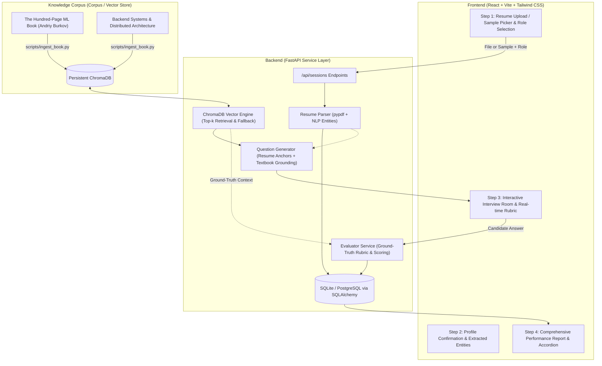

# AI-Powered Role-Based Candidate Screening System

An enterprise-grade, intelligent candidate screening platform that dynamically generates and evaluates technical interview questions tailored to a candidate's resume, targeted job role, and grounded textbook domain literature (*The Hundred-Page Machine Learning Book* by Andriy Burkov and Distributed Systems Architecture Handbooks).

Built with **FastAPI**, **ChromaDB**, **SQLAlchemy**, and **React + Vite + Tailwind CSS**.

---

## 🌟 Key Architecture & Capabilities

1. **Grounded Retrieval-Augmented Generation (RAG)**:
   - **Corpus Ingestion**: Authentic textbook chapters indexed into persistent ChromaDB vector store.
   - **Smart Chunking**: Recursive character chunking (600–800 chars with 100 char overlap).
   - **Dynamic Grounding**: Questions cite specific textbook chapters and definitions; queries automatically fall back to role fundamentals if candidate skills are obscure or non-standard.

2. **Context-Aware Dynamic Questioning**:
   - Rather than static questionnaires, questions are dynamically formulated by marrying candidate resume projects and technical proficiencies with theoretical concepts.
   - Structured 5-turn progression:
     - *Turn 1*: Mathematical Foundations & Empirical Risk
     - *Turn 2*: Optimization Dynamics & Gradient Methods
     - *Turn 3*: Regularization, Sparsity & Generalization Bounds
     - *Turn 4*: Deep Representation / Transactional Concurrency
     - *Turn 5*: Production Diagnostics, Imbalance, Trade-offs & Failure Modes

3. **Ground-Truth Evaluation Engine**:
   - Compares candidate responses directly against retrieved textbook passages.
   - Computes technical accuracy ("High", "Moderate", "Marginal", "Insufficient"), objective scoring (1.0–10.0), recognized strengths, missing theoretical nuances, and model answer summaries.

4. **Production-Ready & Fully Offline Autonomous**:
   - Configurable for **OpenAI** (`gpt-4o-mini`, `gpt-4o`) and **Gemini** (`gemini-1.5-flash`).
   - Includes a deterministic semantic evaluation engine that operates out of the box with zero external API key requirements.

---

## 🏗️ System Architecture Flow



---

## 📁 Repository Structure

```
.
├── backend/
│   ├── app/
│   │   ├── main.py                  # FastAPI app entrypoint, CORS & lifespan
│   │   ├── core/
│   │   │   ├── config.py            # Pydantic-settings (.env configuration)
│   │   │   ├── database.py          # SQLAlchemy engine, session & init_db
│   │   │   └── llm.py               # Multi-provider client (OpenAI, Gemini, Local)
│   │   ├── models/
│   │   │   ├── session.py           # CandidateSession DB model
│   │   │   └── turn.py              # InterviewTurn DB model
│   │   ├── schemas/
│   │   │   ├── candidate.py         # Parsed profile validation schemas
│   │   │   ├── session.py           # Turn request & evaluation schemas
│   │   │   └── report.py            # Comprehensive final report schemas
│   │   ├── services/
│   │   │   ├── resume_parser.py     # PDF/Text extractor & entity parser
│   │   │   ├── rag_engine.py        # ChromaDB index loader & top-k retrieval
│   │   │   ├── question_gen.py      # Grounded scenario question generator
│   │   │   └── evaluator.py         # Ground-truth answer evaluator
│   │   └── api/
│   │       └── routes/
│   │           ├── sessions.py      # Session lifecycle & turn execution routes
│   │           └── meta.py          # Available roles, samples & health check
│   ├── data/
│   │   ├── corpus/                  # Authentic textbook chapters
│   │   ├── sample_resumes/          # Pre-loaded PDF & TXT test resumes
│   │   └── chroma_db/               # Persistent indexed vector store
│   ├── scripts/
│   │   ├── ingest_book.py           # Standalone CLI textbook ingestion script
│   │   └── generate_sample_resumes.py # PDF/TXT generator for test profiles
│   ├── tests/                       # Pytest test suite (12 passed tests)
│   ├── requirements.txt
│   ├── pytest.ini
│   └── .env.example
├── frontend/
│   ├── src/
│   │   ├── components/
│   │   │   ├── Header.tsx           # Navbar & active role badge
│   │   │   ├── Stepper.tsx          # 4-stage visual progress stepper
│   │   │   ├── ResumeUploadStep.tsx # Drag & drop upload & sample cards
│   │   │   ├── ProfileReviewStep.tsx# Parsed skills, domains & highlights
│   │   │   ├── InterviewRoomStep.tsx# Active question, editor & live rubric
│   │   │   └── ReportStep.tsx       # Overall score dial, feedback & accordion
│   │   ├── services/
│   │   │   └── api.ts               # Typed REST API client
│   │   ├── types/
│   │   │   └── index.ts             # TypeScript definitions
│   │   ├── App.tsx                  # Main state orchestrator
│   │   ├── main.tsx                 # React DOM mount
│   │   └── index.css                # Tailwind design system & tokens
│   ├── package.json
│   ├── vite.config.ts
│   └── tailwind.config.js
└── README.md
```

---

## 🚀 Quickstart Guide

### Prerequisites
- Python 3.11+
- Node.js 20+
- `uv` (recommended) or standard `python3 -m venv` and `pip`

---

### Step 1: Backend Setup

```bash
cd backend

# Create virtual environment and install dependencies
uv venv .venv
source .venv/bin/activate
uv pip install -r requirements.txt

# (Optional) If using standard pip:
# python3 -m venv .venv && source .venv/bin/activate && pip install -r requirements.txt

# Ingest textbook corpus into ChromaDB
python scripts/ingest_book.py

# Start FastAPI development server
uvicorn app.main:app --host 0.0.0.0 --port 8000 --reload
```

Backend will be accessible at `http://localhost:8000`.
Interactive Swagger API docs available at `http://localhost:8000/docs`.

---

### Step 2: Frontend Setup

Open a new terminal:

```bash
cd frontend

# Install npm packages
npm install

# Start Vite development server
npm run dev
```

Frontend will be accessible at `http://localhost:5173`.

---

## 🧪 Running Automated Tests

Run the full pytest suite covering PDF extraction, RAG retrieval, question generation, answer evaluation, and the complete 5-turn session lifecycle:

```bash
cd backend
source .venv/bin/activate
pytest -v
```

**Results**: 12 passed tests across all service layers in ~3.8s.

---

## 📡 REST API Reference

| Endpoint | Method | Description |
|---|---|---|
| `/api/health` | `GET` | Health check, vector database chunk count, and provider status. |
| `/api/roles` | `GET` | Returns supported roles (`AI/ML Engineer`, `Backend Engineer`, `Data Scientist`). |
| `/api/sample-resumes` | `GET` | Lists pre-loaded sample candidate resumes for 1-click test runs. |
| `/api/sessions/start` | `POST` | Accepts resume (`file` or `sample_resume_id`) + `role`. Returns `session_id` & parsed profile. |
| `/api/sessions/{id}/next-question` | `GET` | Generates or fetches current question (e.g. Turn 1 to 5) with cited textbook concept. |
| `/api/sessions/{id}/submit-answer` | `POST` | Accepts candidate answer, scores against ground truth, and advances turn. |
| `/api/sessions/{id}/report` | `GET` | Returns overall score, hiring tier, strengths, improvement areas, and full turn audit. |

---

## 📖 Textbook Grounding & RAG Specification

- **Textbook Knowledge Bases**:
  - *The Hundred-Page Machine Learning Book* (Andriy Burkov)
    - Chapter 2: Supervised Learning, ERM & Loss Functions
    - Chapter 3: Fundamental Algorithms (SVM, Logistic Regression, Trees)
    - Chapter 4: Optimization, SGD & Regularization (L1 vs L2)
    - Chapter 5 & 7: Model Evaluation, ROC-AUC, PR Curves & Class Imbalance
    - Chapter 6: Deep Learning, Backpropagation, BatchNorm & Dropout
  - *Backend Systems & Architecture Handbook*
    - Module 1: Concurrency, Event Loops, Locks & Thread Pools
    - Module 2: Storage Engines (B+ Trees vs LSM Trees) & ACID Isolation Levels
    - Module 3: Distributed Caching, CAP Theorem & Circuit Breaker Resiliency
- **Chunk Size**: 600–800 characters (configured at 700) with 100 character overlap.
- **Traceability**: Context -> Question -> Answer -> Evaluation -> Storage.

---

## ⚙️ Environment Configuration (`.env`)

```ini
PROJECT_NAME="Role-Based AI Candidate Screening System"
VERSION="1.0.0"
API_PREFIX="/api"

DATABASE_URL="sqlite:///./data/screening.db"
CHROMA_PERSIST_DIR="./data/chroma_db"

# LLM Provider ('auto', 'openai', 'gemini', or 'local')
LLM_PROVIDER="auto"
OPENAI_API_KEY=""
OPENAI_MODEL="gpt-4o-mini"
GEMINI_API_KEY=""
GEMINI_MODEL="gemini-1.5-flash"

QUESTIONS_PER_SESSION=5
CHUNK_SIZE=700
CHUNK_OVERLAP=100
RAG_TOP_K=3
```
*Note: If no API keys are provided, the built-in deterministic semantic engine seamlessly evaluates and generates questions without error.*
